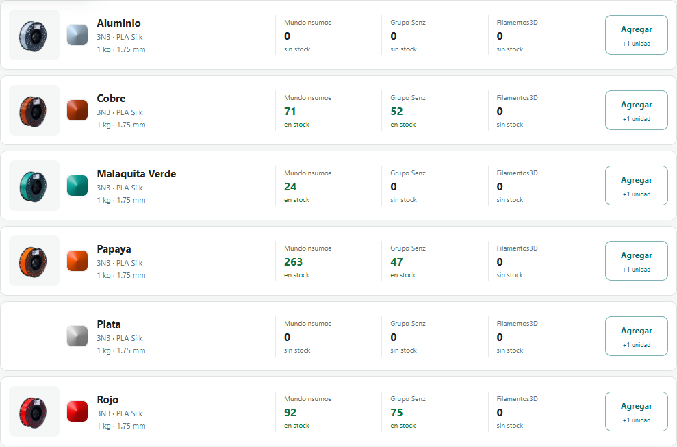

# Revision de fotos y referencias de color: 3N3 Silk

Fecha de consulta: 16 de octubre de 2026. Presentacion investigada: PLA Silk 3N3, 1,75 mm, 1 kg.

## Resultado

| Color del catalogo | Foto verificada | Referencia Pantone publicada | Referencia visual del selector |
| --- | --- | --- | --- |
| Aluminio | Si; etiqueta Aluminio y foto principal de Filacolor | No encontrada en las fuentes revisadas | Estimada desde la foto, confianza media |
| Cobre | Si; variante y etiqueta Cobre | No encontrada en las fuentes revisadas | Estimada desde la foto, confianza media |
| Malaquita Verde | Si; variante Verde Malaquita y etiqueta Malaquita Verde | No encontrada en las fuentes revisadas | Estimada desde la foto, confianza media |
| Papaya | Si; variante y etiqueta Papaya | No encontrada en las fuentes revisadas | Estimada desde la foto, confianza media |
| Plata | Pendiente; no se verifico una foto individual de este color | No encontrada en las fuentes revisadas | Estimada solo por nombre, confianza baja |
| Rojo | Si; variante y etiqueta Rojo | No encontrada en las fuentes revisadas | Estimada desde la foto, confianza media |

Las cinco fotos aceptadas son del mismo conjunto: carrete solo con filamento, perspectiva de tres cuartos, fondo transparente, sin caja y originales de 1024 x 1024. Se conservan los archivos originales sin retocar. No se usa una foto de Aluminio para representar Plata.



## Fuentes y evidencia

- [Filacolor: 3N3 Silk](https://filacolor.com.ar/producto/3n3-silk/). La ficha confirma marca, material, acabado sedoso, diametro y peso. Su formulario publico vincula fotos individuales a Cobre, Papaya, Rojo y Verde Malaquita. La foto principal tiene nombre de archivo y etiqueta Aluminio. El selector enumera Plata, pero el formulario y la API publica del producto no devolvieron foto individual de Plata. No publica Pantone, EAN ni SKU de fabricante; SKU general N/A y SKU de variantes vacios.
- [API publica de Filacolor, producto 11222](https://filacolor.com.ar/wp-json/wc/store/v1/products/11222). Corrobora la foto principal y las cuatro variantes anteriores. Sus identificadores de variante son identificadores de esa tienda, no codigos de fabricante.
- [MundoInsumos: 3N3 Silk](https://www.mundoinsumos.com.ar/pla-silk-filamento-impresora-3d-3n3-silk-1-75mm-kilo--det--3N3SILKKILO). La foto generica muestra caja y carrete con etiqueta PLA Cobre, sin identificacion Silk; se descarta para esta serie tanto por identidad como por estilo. La planilla de stock confirma los nombres Malaquita Verde y Plata.
- [i3D: 3N3 PLA Silk](https://www.i3dtienda.com.ar/productos/3n3-pla-silk/). La ficha enumera Aluminio, Cobre, Malaquita Verde, Oro, Papaya, Plata y Rojo. No se encontro Pantone ni se pudo verificar una foto individual de Plata. El texto se pudo revisar mediante busqueda web; la descarga directa respondio 403. Oro no se agrega como oferta porque no figura en las fuentes de stock capturadas.
- [CREA 3D: linea Silk](https://crea3d.ar/filamento-pla-pla/pla-silk/). Se verificaron las publicaciones de Papaya, Rojo, Cobre y Malaquita Verde en el texto publico. La descarga directa respondio 403 y no se uso como fuente de imagenes.
- [Tritan: Verde Malaquita 3N3 Silk](https://www.tritan3d.com.br/produtos/filamento-pla-3n3-silk-verde-malaquita-1-75mm-1kg-l22h1/). Confirma el nombre comercial y formato; no se encontro referencia Pantone en el texto consultado. Sus parametros son recomendaciones de ese vendedor.
- [NTH](https://www.nth.com.ar/es/), [descargas de NTH](https://www.nth.com.ar/es/content/12-descargas) y [catalogo de Grilon3](https://grilon3.com.ar/productos/). No se encontro carta Pantone ni ficha oficial especifica de estos seis colores 3N3 Silk. No se transfieren codigos Pantone de Grilon3, otras marcas o PLA comun por parecido del nombre.

## Datos tecnicos y limites

Se incorporan como identidad comprobada PLA Silk, acabado silk, diametro 1,75 mm y peso 1 kg. Las fotos muestran etiquetas 3N3 Silk de NTH. No se confunden numeros de lote/orden de fabricacion de esas etiquetas con SKU, EAN o Pantone.

Filacolor recomienda boquilla de 200 a 220 grados, cama de 50 a 60 y velocidades de 40 a 60 mm/s. Son recomendaciones del vendedor, no una ficha tecnica certificada del fabricante; no se agregan como requisitos del producto. Tampoco se incorporan afirmaciones de seguridad o resistencia del copy comercial.

Los RGB del selector son orientativos: mediana de una zona visible de filamento en cada foto, con filtros de transparencia y sombras. La zona, los filtros, el RGB, el numero de pixels y el SHA-256 del original quedan en `centraldefilamentos/data/3n3_reviewed_metadata.json`. No representan mediciones fisicas ni equivalencias Pantone; iluminacion, pantalla y lote pueden cambiar la apariencia. Plata conserva el aviso de estimacion por nombre y foto pendiente.

## Persistencia y aplicacion

`3n3_reviewed_metadata.json` guarda las fotos revisadas y su procedencia por identidad exacta. El build y la aplicacion de imagenes 3N3 combinan este registro con la cache de Filamentos3D. Solo los registros con foto comprobada tienen prioridad; un registro pendiente nunca borra una foto futura de otra fuente.

Los originales estan en `public/assets/reviewed/` y las miniaturas en `public/assets/thumbs/reviewed/`. No se agregan proveedores de stock ni se modifican cantidades a partir de estas fichas comerciales.

Para aplicar nuevas revisiones sin consultar stock:

```powershell
python -m centraldefilamentos.update_filamentos3d_images
python -m centraldefilamentos.apply_color_estimates
python -m centraldefilamentos.generate_material_swatches --stock-json public/data/stock.json --public-dir public
```
